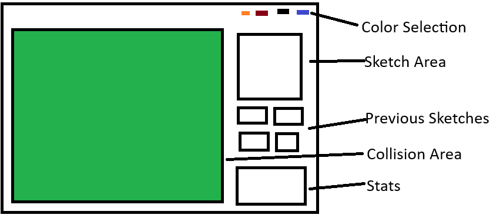

# Plan - SketchImpact

## Group 2

- Rene Sebastian
- Shabaz Malik
- Frederick David Vandermoeten

## Problem Statement

We have highly optimized techniques for collision detection between geometric primitives
such as circles, rectangles or polygons.
However, for user-generated freeform sprites, the narrow phase becomes expensive.
We try to implement a lightweight AI model that predicts collisions between sprite pairs
to filter the amount of collisions we have to check.

## Game

The player can draw their own sketches and watch them collide on a 2D billiard table.
The player can influence their sketches speed by dragging/ clicking with the mouse.
There is visual feedback showing stats such as the number of skipped collision checks.

## Techniques

- Broad and Narrow Collision detection
- some Spatial Data Structure
- AABB/ OBB
- NN for filtering before narrow phase, or to replace narrow phase

## Workflow

1. Build baseline game without AI
2. Generate labeled dataset of sprite pairs, relative offsets and collision outcomes
3. Train a CNN model
4. Integrate it into the game
5. Evaluate performance and accuracy
