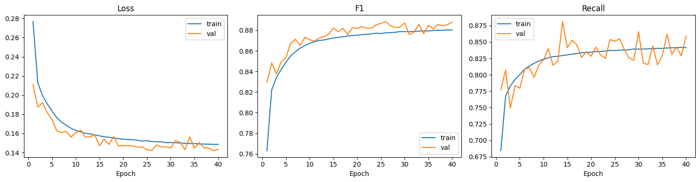
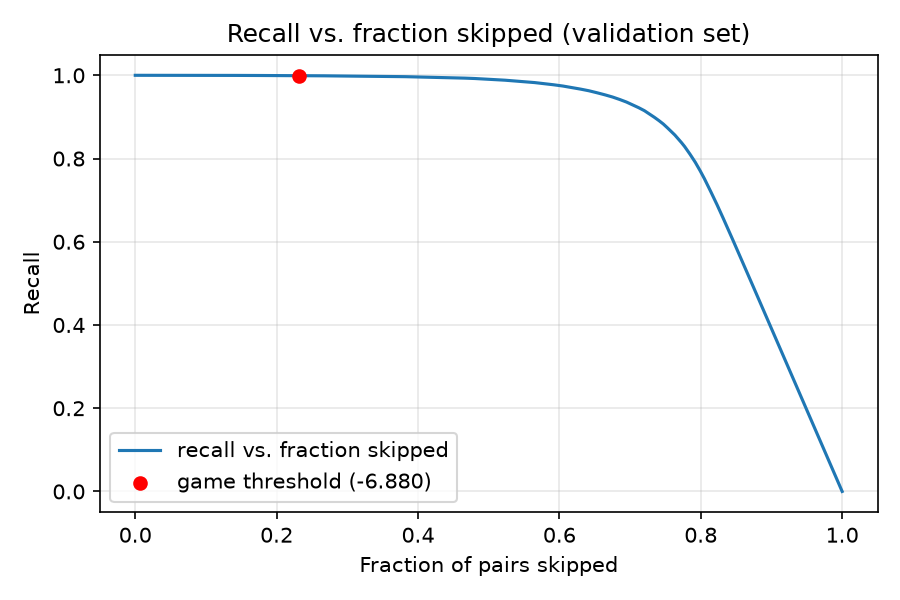
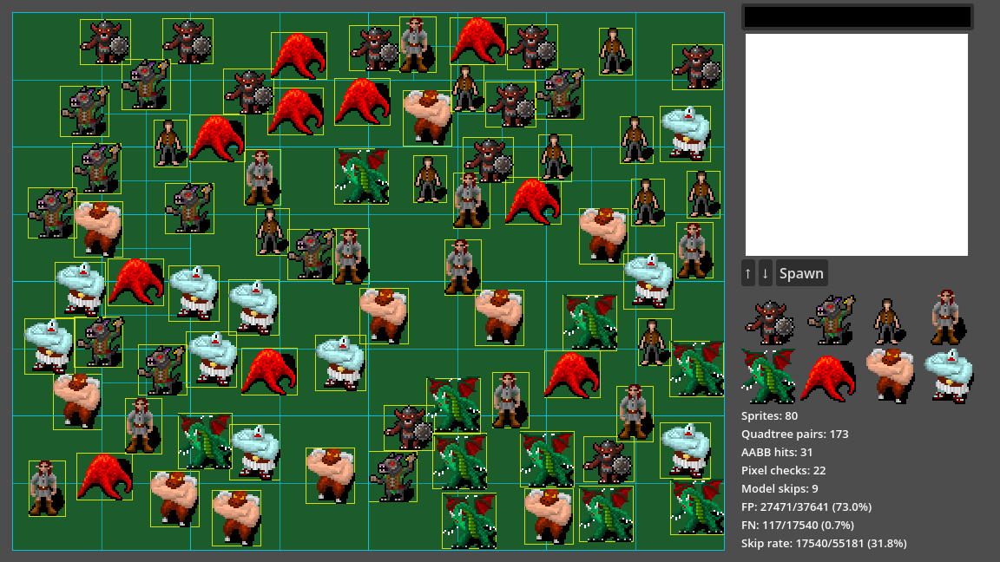

# SketchImpact: CNN-Filtered Collision Detection for Freeform Sprites

## Overview

1. [Problem Statement](#sec1)
2. [Related Work](#sec2)
3. [Baseline Implementation](#sec3)
4. [Dataset Generation](#sec4)
5. [Model Design & Training](#sec5)
6. [Integration into the Game](#sec6)
7. [Evaluation](#sec7)
8. [Conclusion](#sec8)
9. [AI usage](#sec9)

## 1. Problem Statement {#sec1}

Collision detection between geometric primitives such as circles, axis-aligned boxes, and convex polygons is a well-established problem. Decades of computational geometry research have produced closed-form or near-constant-time tests for these shapes.
Real-time applications depend on these methods, employing inexpensive bounding-volume tests in a broad phase to eliminate most candidate pairs. Only those pairs that pass this stage proceed to a more precise and computationally expensive narrow phase.

However, for arbitrary user-drawn sprites, the silhouette may be concave or disconnected. In such cases, the only accurate method is a pixel-perfect check, which verifies whether the sprites' alpha masks overlap at any pixel.

Although this check is exact, it is computationally expensive. Every opaque pixel of one sprite must be compared against the other's mask, and this process must be repeated for every candidate pair that passes the broad phase in each frame.

The objective of this project is to reduce the frequency of these expensive exact checks without altering the simulation's outcome. To achieve this, we introduce a lightweight learned filter between the broad and narrow phases. Given a pair of sprites and their relative offset, a small convolutional neural network (CNN) predicts the likelihood of collision. If the model is confident that the pair is not colliding, the pixel-perfect check can be omitted.

To demonstrate this approach, we developed the game SketchImpact, which allows players to sketch their own 32x32 sprites and observe their collisions on a simulated billiard table. Subsequently, we generated a collision dataset, trained a CNN on this data, and integrated the model into the simulation.

We also evaluate how much work this approach saves and its accuracy.

## 2. Related Work {#sec2}

### AI in collision detection

Since general approaches work well in most applications, AI in collision detection is more niche. Guo et al. [[1]](#src1) learn an implicit representation of a robot's collision space from examples generated from the robot's geometry, enabling collision queries to be answered directly from joint configurations without performing geometric collision checks at runtime. For deformable objects, collision detection can also be expensive, motivating several recent works that use learned models to approximate or accelerate collision queries, such as Zesch et al. [[2]](#src2), Tan et al. (2021) [[3]](#src3), and Tan et al. (2022) [[4]](#src4).

In these studies, the learned model seldom replaces geometric reasoning entirely. For example, Guo et al. [[1]](#src1) employ a learned collision model to accelerate collision queries during motion planning. Tan et al. (2021) [[3]](#src3) predict non-penetration constraints to guide optimization toward collision-free poses. Tan et al. (2022) [[4]](#src4) combine learning with an exact collision handler by querying it during training whenever the model is uncertain. These examples illustrate a pattern in which AI and exact methods are used in conjunction, rather than the network fully replacing classical collision detection.

We adopt a similar approach for SketchImpact. The CNN does not replace the pixel-perfect narrow phase but instead serves as a filter preceding it. A confident false positive results only in additional computation, not a loss of accuracy. However, a false negative may cause a real collision to be missed, which is why the operating threshold is tuned for very high recall rather than for overall accuracy [(Section 7)](#sec7).

Our setting differs from previous work in both scale and domain. While prior research focuses on high-degree-of-freedom robot configurations or 3D deformable meshes, we address pairwise collisions between small 2D freeform sprites using their rasterized alpha masks and relative offsets. Previous approaches often involve higher-dimensional and more computationally intensive scenarios, necessitating extensive data generation and training pipelines that are impractical for a two-week implementation project.

### CoordConv

Because our model functions as a standard image classifier, it lacks an inherent understanding of position. The convolutional filter is shared across the entire image and applied uniformly, providing the network with information about the local appearance of each sprite but not their relative positions.

Liu et al. [[5]](#src5) demonstrate that this translation-equivariance makes even simple coordinate-dependent tasks, such as mapping a pixel index to a one-hot image, challenging for conventional CNNs to learn. They propose addressing this limitation by concatenating additional channels of normalized coordinate values to the input, enabling each convolutional layer to access positional information directly rather than inferring it indirectly.

We implement this approach directly. In addition to the two sprites' 32×32 alpha masks, our model's input includes two channels broadcasting the relative offset (dx, dy) as constants and two channels containing normalized x and y coordinate grids (Section 5). This design allows the network to relate a pixel in one sprite's mask to the corresponding location in the other's frame without needing to learn offset arithmetic implicitly from data.

## 3. Baseline Implementation {#sec3}

Before any learned component was introduced, we built SketchImpact as a self-contained 2D billiard simulator in Godot 4.7. This baseline establishes the drawing tool, the sprite representation, and the collision pipeline that the CNN filter later slots into [(Section 6)](#sec6); every pair that passes the broad phase here proceeds directly to the pixel-perfect narrow phase, with no skipping.

### Scene structure

The game is composed of two top-level scenes: a billiard table that runs the simulation, and a drawing window that produces the sprites fed into it.

The root scene, `sketch_impact.tscn`, is a `Node2D` with two children. The first, `BilliardTable`, is its own scene (`billiard_table.tscn`) driven by `billiard_table.gd`; it contains a `Background` `ColorRect` sized 820x620, a `Sprites` node that acts as the runtime container for spawned `sprite_body` instances, and a `HelpOverlay` panel showing the keybinding reference, toggled with **H**. The second child, `DrawWindow`, is its own scene (`draw_window.tscn`) driven by `save_image.gd`; nested inside its layout containers are the `TextureRect` canvas, a `ColorPickerButton`, the Save/Load/Spawn buttons, an eight-slot `GridContainer` preview, and a `StatsHud` instance (`stats_hud.tscn`, driven by `stats_hud.gd`) showing live collision and evaluation stats, toggled with **S**.

`sprite_body.tscn` is a minimal Node2D + Sprite2D scene, instantiated at runtime once per sprite by `billiard_table.gd`.

### From drawing to simulation

Players paint directly onto a 32x32 `Image` (`texture_rect.gd::paint_at_mouse`), setting individual pixels to the currently selected color on click and drag. Pressing **Save** (`save_image.gd::_on_down_pressed`) duplicates that image into an eight-slot history strip, writes it to `user://sprites/sprite_NNNN.png`, and clears the canvas for the next sketch. Pressing **Spawn** hands the selected image (or the canvas, if nothing is selected) to `billiard_table.spawn_sprite()`, which rejects images that are fully transparent, extracts the alpha channel into a flat byte array, and places the sprite at a random position with a random velocity, biased so its tight bounding box starts fully inside the table.

### Sprite representation

Rather than modeling each sprite as an object, `billiard_table.gd` keeps a struct-of-arrays: parallel arrays for position, velocity, the alpha-mask pixel data, the corresponding scene node, and a precomputed tight bounding box relative to the sprite's center. All arrays share the same index per sprite, so the whole simulation state is just a handful of flat arrays scanned every frame.

### Collision pipeline

Each physics frame, `billiard_table.gd::_physics_process` advances every sprite and then narrows the O(n²) set of possible pairs down to the ones that actually need an exact check, in three stages:

1. **Quadtree broad phase.** All current axis-aligned bounding boxes are inserted into a quadtree (`_QuadNode`, max 4 items per node, max depth 5) covering the table. Each leaf reports the pairs of sprites it contains, deduplicated across quadrants into a dictionary keyed by `[min_index, max_index]`. This is the *quadtree pairs* count shown on the HUD.
2. **AABB check.** For every candidate pair, the two bounding boxes are tested for overlap with `Rect2.intersects`. Pairs that pass become *AABB hits*.
3. **Pixel-perfect narrow phase.** `_pixel_collision(i, j)` walks sprite `i`'s opaque pixels from the side closest to `j` and, for each one, checks both the floor and ceiling candidate pixel of `j` at the corresponding sub-pixel offset. This handles the fact that sprite centers rarely align to a whole-pixel offset, and returns the first colliding point found, or "no collision" if none exists.

A pair that survives all three stages is resolved by swapping the velocity components along the collision normal (only if the sprites are still approaching each other, to avoid re-triggering on overlapping frames) and pushing both sprites apart by a fixed amount along that normal.

The HUD (`stats_hud.gd`) reports all three counts each frame: *Sprites*, *Quadtree pairs*, *AABB hits*, *Pixel checks*. This gives a direct, always-visible measure of how much work each phase is doing and is what later evaluation (Section 7) compares the CNN filter's *Model skips* against.

## 4. Dataset Generation {#sec4}

Training a CNN requires far more labelled `(sprite_i, sprite_j, dx, dy, collided)` tuples than a play session could ever produce, so the dataset is generated offline in Python (`dataset/generate_dataset.py`) rather than logged from Godot. To keep the labels trustworthy, generation reimplements the exact game rule rather than an approximation of it.

### Sprite corpus

213 real sprites were selected from an open source dataset [[6]](#src6). Additionally, 500 synthetic 32×32 alpha masks were created, split evenly across four generators: organic blobs grown by random-walk expansion, random convex polygons, simple primitives (circle, rectangle, cross, L-shape), and thresholded smoothed noise.

### Sampling

For each of up to 5,000 randomly chosen sprite pairs, `aabb_overlap_range` first restricts candidate offsets to the interval where the two sprites' tight bounding boxes can overlap at all, matching the broad-phase `Rect2.intersects` check from the baseline [(Section 3)](#sec3). We then label multiple offsets of the pair via a pixel-perfect algorithm, while keeping a reasonable target positive rate (25%).

### Output format

`dataset.npz` stores each sprite's pixel data once (713 × 32×32 uint8) and references it by index from lightweight per-sample records (`i`, `j`, `dx`, `dy`, `label`), rather than duplicating each sample's own copy of the two masks. The compressed file holds about 2.46 million samples (25.4% positive) in 6.6 MB; storing each sample as its own pair of 32×32 masks instead would cost on the order of 5 GB. The actual multi-channel network input is assembled per sample by the PyTorch `DataLoader` (Section 5), so that representation is free to change without regenerating the dataset.

## 5. Model Design & Training {#sec5}

### Input representation

Each sample is a `(6, 32, 32)` float32 tensor built by `CollisionDataset.__getitem__` (`dataset/dataset_loader.py`): channel 0 and 1 are `sprite_i`'s and `sprite_j`'s alpha masks; channels 2–3 broadcast the relative offset `(dx, dy)`, each divided by 32, as constants across the whole channel; channels 4–5 are fixed `x`/`y` coordinate grids linspaced over `[0, 1]`. Channels 2–5 are the CoordConv-style constant-coordinate injection discussed in [Section 2](#sec2).

### Data augmentation

Because the geometry of a collision is invariant under joint rotation or mirroring of both sprites and their offset, `dataset_loader.py` applies random dihedral (D4) transform to `alpha_i`, `alpha_j`, and `(dx, dy)` together, on the fly in `__getitem__`. This label invariance was verified empirically against the floor/ceil rule in `pixel_collision.py` over 2,000 random trials before relying on it. Augmentation gives an effective 8x increase in training variety without inflating `dataset.npz`. The validation split is left untransformed so validation metrics stay stable and comparable across runs.

### Architecture

`CollisionCNN` (`dataset/model.py`) is a small three-block convolutional network: `Conv(6→16)` + BatchNorm + ReLU, then `Conv(16→32)` + BatchNorm + ReLU + `MaxPool(2)`, then `Conv(32→64)` + BatchNorm + ReLU + `MaxPool(2)`, reducing the input to a `(64, 8, 8)` feature map. This is flattened to 4096 values and passed through `Linear(4096→64)` + ReLU + `Linear(64→1)`, producing a single raw logit (paired with `BCEWithLogitsLoss`). Global average pooling was deliberately avoided in favor of flattening: a collision is a sparse, spatially local signal, and averaging the feature map across all positions would dilute a single corner-touch to near zero. The model has roughly 286K parameters, dominated by the first fully-connected layer.

### Training procedure

Training runs in `dataset/train.ipynb` against `dataset.npz`, using the Adam optimizer (lr=1e-3) with batch size 512; both train and validation loss drop sharply in the first ~10 epochs before flattening out around 0.15 for the remaining 30, with validation loss tracking train loss closely rather than diverging, indicating no overfitting. Training was done on a free colab instance and took around 2.5 hours.

### Export

The best checkpoint is exported to ONNX as `model.onnx` for inference. This is also the artifact `dataset/eval.py` uses to pick the decision threshold and compute the accuracy figures reported in [Section 7](#sec7).

## 6. Integration into the Game {#sec6}

### Why a subprocess

We decided to use a Python subprocess to run the model instead of the existing onnx GDExtension because of ease of integration.

### Protocol

`collision_model.gd` spawns the server once with `OS.execute_with_pipe("uv", ["run", "--project", ..., "python", "inference_server.py"])` and speaks a small line-delimited JSON protocol over its stdio pipe: `register` sends one sprite's alpha mask by index when it is spawned, `clear` drops all registered sprites when the table is reset, `query` sends a batch of candidate pairs as `[i, j, dx, dy]` and gets back one boolean `maybe` flag per pair, and `ping` is a liveness check. The server replies to a startup handshake with `{"ready": true, "provider": ...}` before `collision_model.gd` will start relying on it.

### Wiring into the collision pipeline

In `billiard_table.gd::_physics_process`, after the AABB stage produces its candidate pairs [(Section 3)](#sec3), each pair's offset is converted from screen space to sprite-pixel space and the whole batch is sent to the model in a single `query_pairs` call per frame. A pair the model flags `true` ("maybe colliding") proceeds to the real `_pixel_collision` check and counts toward *narrow checks*; a pair it flags `false` is skipped and counts toward *model skips*, both shown on the HUD alongside the existing broad-phase counters (`stats_hud.gd`). The threshold applied to the model's logit, `-6.880`, was not chosen for overall accuracy but read off `dataset/eval.py`'s recall-vs-threshold curve at the operating point closest to 99.9% recall on the validation set — consistent with the high-recall requirement argued for in [Section 2](#sec2), since a missed collision is a visible simulation error while a missed skip only costs some extra computation.

### Fail-open behaviour and live evaluation

`collision_model.gd` is designed to fail open: if `uv` isn't on `PATH`, the inference script is missing, or the server ever stops responding, `is_ready()` returns false and `query_pairs` returns "maybe" for every pair, so the game degrades exactly to the pre-CNN baseline instead of silently dropping collisions. Two runtime toggles support this: **toggle model** disables the CNN filter without tearing down the sprite registrations kept on the Python side, and **toggle eval** turns on *eval mode*, which additionally runs the ground-truth `_pixel_collision` check on pairs the model would have skipped, tracking false positives and false negatives live against the model's actual predictions during play. This gives an in-game accuracy measurement that is independent of, and a live complement to, the offline validation numbers from `dataset/eval.py` reported in [Section 7](#sec7).

## 7. Evaluation {#sec7}

We evaluate the model along two axes: offline, against the held-out validation split used during training, and live, inside the running game, where the pair distribution is whatever a real session of play actually produces rather than a random sample.

### 7.1 Offline validation

`dataset/eval.py` loads `model_best.pt`, runs it over the validation split (269,079 pairs, 25.6% positive), and sweeps the decision threshold to trace recall, precision, and fraction-of-pairs-skipped as functions of the threshold. The operating threshold used in the game, `-6.880` [(Section 6)](#sec6), was chosen as the highest threshold that still reaches at least 99.9% recall on this validation curve, per the high-recall requirement argued for in [Section 2](#sec2): a missed collision is a visible simulation bug, while a missed skip only costs one extra pixel-perfect check.

| Target recall | Threshold | Actual recall | Precision | Skipped |
|---|---|---|---|---|
| 99.9% | -6.880 | 0.9991 | 0.3325 | 23.2% |
| 99.5% | -4.774 | 0.9952 | 0.4415 | 42.4% |
| 99.0% | -4.071 | 0.9910 | 0.5012 | 49.5% |
| 98.0% | -3.369 | 0.9825 | 0.5772 | 56.5% |
| 95.0% | -2.246 | 0.9530 | 0.7258 | 66.5% |
| 90.0% | -1.263 | 0.9070 | 0.8503 | 72.7% |

At the game's operating threshold (confusion matrix over the 269,079-pair validation set): TP = 68,687, FP = 137,917, FN = 63, TN = 62,412 — 62,475 of 269,079 checks (23.2%) skipped, at 99.91% recall and 33.25% precision. The precision is deliberately low: the curve above shows precision only breaks 50% once recall is allowed to drop to ~99%, confirming that pushing for near-perfect recall on this task means accepting that most flagged pairs turn out not to collide, which is the correct tradeoff given a false negative is a visible bug and a false positive is one extra pixel check.

### 7.2 In-game evaluation

Offline validation pairs are drawn uniformly at random from the sprite corpus, but actual gameplay produces a very different, non-uniform distribution of offsets and sprite combinations — closely packed clusters, repeated sprite types, and offsets biased by physical motion rather than sampled independently. To check whether the offline operating point still holds under this shift, `billiard_table.gd` supports an *eval mode* (toggled at runtime): every AABB candidate still receives the exact pixel-perfect check regardless of what the model predicts, and the model's `maybe` flag is compared against that ground truth live, accumulating false positives (flagged as "maybe colliding" but no actual collision) and false negatives (skipped, but a real collision was missed) [(Section 6)](#sec6).

We ran scenario 2 (`scenarios/scenario_2.json`, 80 sprites drawn from the real sprite corpus) in eval mode and read the following totals off the HUD:

| Metric                      | Value                   |
| --------------------------- | ----------------------- |
| Flagged ("maybe colliding") | 37,641                  |
| — of which false positives  | 27,471 (73.0%)          |
| Skipped                     | 17,540                  |
| — of which false negatives  | 117 (0.7%)              |
| Skip rate                   | 17,540 / 55,181 (31.8%) |

From these, true positives = 37,641 - 27,471 = 10,170, total real collisions = 10,170 + 117 = 10,287, giving a **live recall of 98.86%** and a **live precision of 27.0%** on flagged pairs.

The low precision is expected and by design — the threshold was picked purely for recall, so most flagged pairs still resolve to "no collision" once pixel-checked, and every one of them is only an extra check, not a correctness issue. The more notable result is the recall gap: 98.86% live versus the 99.9% target measured offline. This is a genuine distribution-shift effect rather than a bug — scenario 2's tightly packed, sprite-repeating layout produces offset/pair combinations the offline random sampling under-represents — and it is the honest number to report rather than the offline figure alone.

We focus this evaluation on correctness (recall/precision) rather than raw throughput, since the number of pixel checks skipped is a direct, deterministic function of the recall/precision tradeoff already characterized above — the accuracy curve is the result that matters for judging whether the filter is safe to use, not a separate wall-clock benchmark.

### 7.3 Honest baseline: a lookup table would win on engineering merits

It is worth being explicit that a precomputed lookup table would outperform the CNN on every engineering axis that matters for this game. Built per sprite pair at spawn time — the same FFT cross-correlation already used to generate ground-truth labels in Section 4, run once over all offsets and cached — it gives an exact, O(1) lookup for every subsequent frame the pair exists, with no training pipeline and no Python subprocess or IPC protocol to integrate with Godot. Unlike a table over a fixed, bounded sprite corpus, this per-pair construction works for arbitrary freeform sprites just as well as the CNN does, so it is not a fallback that only works because the sprite set is limited. The CNN is included here because a learned filter over exact collision detection is the assigned academic contribution of this project, not because it is the better engineering choice. Section 7.2's recall gap is itself a consequence of this tradeoff: a lookup table has no such gap, because it has no distribution to shift under.

## 8. Conclusion {#sec8}

SketchImpact demonstrates the full pipeline this project set out to build: a self-contained 2D billiard game with quadtree and AABB broad-phase and pixel-perfect narrow-phase collision [(Section 3)](#sec3), an offline dataset generator that reimplements the exact game rule as ground truth [(Section 4)](#sec4), a small CoordConv-style CNN trained to predict collision likelihood from two alpha masks and their offset [(Section 5)](#sec5), and a fail-open runtime integration that gates the narrow-phase check behind the model's prediction without ever silently dropping a collision [(Section 6)](#sec6).

The approach works as intended in the sense that matters most for a game: because the operating threshold is tuned for recall rather than accuracy, and the integration fails open whenever the model is unavailable, the simulation never becomes visibly wrong as a result of adding the CNN — it only does more or less extra work. At the same time, the live evaluation in Section 7.2 shows this guarantee is closer to "very high recall" than "no missed collisions": at 98.86% live recall, a session of real play will occasionally miss a collision the offline validation curve promised would be caught, because gameplay pair distributions are not the offline validation distribution. The 31.8% skip rate measured in the same run is a real but modest saving relative to the pre-CNN baseline, and — as argued in Section 7.3 — a per-pair lookup table built from the same exact FFT correlation used for dataset labeling would deliver a strictly better result (skip rate 100%, recall 100%, no training or IPC); the CNN's value here is what it demonstrates about learning collision geometry from raw masks, not a practical performance win over the alternative.

Future work would prioritize closing the offline/live recall gap identified in Section 7.2, most directly by generating training pairs that better match actual gameplay distributions (clustered positions, repeated sprites) rather than uniform random sampling, and by extending the in-game eval-mode harness into an automated regression check that can be re-run whenever the model or dataset changes. A second direction would be to turn Section 7.3's engineering argument from an assertion into a measurement: build the per-pair lookup table with the same FFT cross-correlation already used for ground-truth labeling in Section 4, and compare its one-time build cost (paid once per spawned sprite pair, then reused every frame via O(1) lookups) against the CNN's fixed per-frame inference cost. The CNN only wins that comparison if sprite pairs churn faster than their tables can be amortized; this evaluation did not measure where that crossover point is, or whether it occurs within the range of sprite counts this game actually produces.

## 9. AI usage {#sec9}

The initial game was developed without AI. The NN model and later tweaks to the game were developed via Claude AI. The report was first written without AI, then corrected via Grammarly, and lastly enhanced via Claude Code.

## Sources

1. []{#src1}Guo, G., Goldfeder, J., Ray, A., Dear, T. and Lipson, H., 2025. DeepCollide: Scalable Data-Driven High DoF Configuration Space Modeling using Implicit Neural Representations. In Proceedings of the IEEE/CVF International Conference on Computer Vision (pp. 2668-2678).
2. []{#src2}Zesch, R.S., Witemeyer, B.R., Xiong, Z., Levin, D.I. and Sueda, S., 2022. Neural collision detection for deformable objects. arXiv preprint arXiv:2202.02309.
3. []{#src3}Tan, Q., Pan, Z. and Manocha, D., 2021, May. Lcollision: Fast generation of collision-free human poses using learned non-penetration constraints. In Proceedings of the AAAI Conference on Artificial Intelligence (Vol. 35, No. 5, pp. 3913-3921).
4. []{#src4}Tan, Q., Pan, Z., Smith, B., Shiratori, T. and Manocha, D., 2022, June. N-Penetrate: Active Learning of Neural Collision Handler for Complex 3D Mesh Deformations. In ICML (pp. 21037-21049).
5. []{#src5}Liu, R., Lehman, J., Molino, P., Petroski Such, F., Frank, E., Sergeev, A. and Yosinski, J., 2018. An intriguing failing of convolutional neural networks and the CoordConv solution. Advances in Neural Information Processing Systems, 31.
6. []{#src6}http://opengameart.org/content/dungeon-crawl-32x32-tiles